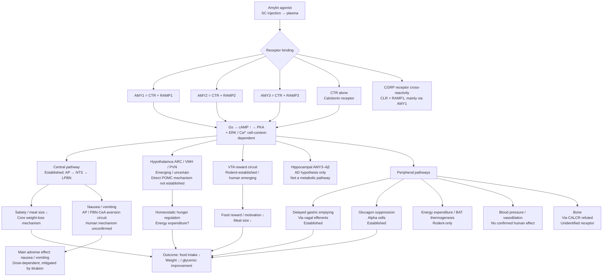

# Amylin Agonists and Weight Loss: Complete Research Report

Compiled: 2026-10-15. Language: English text; drug / target / endpoint names use standard English names.

**Source annotation convention**: All facts in this report come from public web searches (search-index abstracts + page fetches) on 2026-10-15. Each fact carries its source URL and read date; `[index]` means the fact came from a search-index abstract and was not re-opened and verified against the original text in this synthesis; `[verified live]` is used only for items directly confirmed by opening the original text (there are none in this category in this synthesis, stated here explicitly). Any number that is unverified, conflicting, or from a secondary source only is labeled "unverified / secondary source / conflicting" — nothing is guessed.

**Reading note**: The amylin field contains extensive rodent-to-human extrapolation, conflicting numbers across assays, and "subtype-selectivity fold varies by assay" issues. This report uses a three-level evidence grading: **ESTABLISHED** = consistent human + rodent evidence; **EMERGING / RODENT-ONLY** = mostly animal evidence, unconfirmed in humans; **UNVERIFIED** = no direct evidence or conflicting sources.

---

## Summary

- **Endogenous amylin (IAPP)** is a 37-amino-acid peptide hormone co-secreted with insulin from pancreatic beta cells. Its core physiological roles are delaying gastric emptying, suppressing postprandial glucagon, and promoting satiety. Human amylin readily aggregates into amyloid fibrils, which is associated with islet amyloid deposition in type 2 diabetes (T2D); natural human amylin itself is therefore unsuitable as a drug.
- **Receptors**: Amylin receptors AMY1 / AMY2 / AMY3 are all heterodimers of the calcitonin receptor CTR (CALCR) + RAMP1 / 2 / 3 (Class B / Secretin-family GPCRs), signaling mainly through Gs → cAMP → PKA; CGRP receptor cross-reactivity also exists (AMY1 shares RAMP1 with the CGRP receptor).
- **Pathways**: The core weight-loss pathway is the central hindbrain pathway — Area Postrema (AP, a circumventricular organ without a BBB) → NTS → lateral parabrachial nucleus (LPBN) → hypothalamus / forebrain — producing satiety and reduced meal size. Peripheral pathways include delayed gastric emptying and glucagon suppression. The reward pathway (VTA) is established in rodents and emerging in humans; energy expenditure (BAT thermogenesis) has rodent-only evidence; bone and blood-pressure effects are unconfirmed or refuted.
- **Drugs**: The only approved drug is pramlintide (2005, diabetes adjunct, not a weight-loss drug). Long-acting analogs have reached Phase 3 / filing: CagriSema (NDA submitted December 2025), petrelintide (Phase 3 started), eloralintide (Phase 2 completed). Unimolecular dual agonists amycretin / zenagamtide (GLP-1 + amylin) have both oral and subcutaneous data. The first oral small-molecule amylin agonist, ACCG-2671, has completed Phase 1 single-ascending-dose.
- **Drug journey**: Most amylin agonists are given by subcutaneous injection (oral peptides are degraded by GI proteases and have poor permeability); long-acting design relies on fatty-acid acylation + albumin binding. Key distinction — a drug reaches the AP via the bloodstream because the AP is a fenestrated circumventricular organ, which is **not the same as crossing the BBB**; whether the BBB itself is crossed has no direct evidence in humans (no CSF data). Metabolism is mainly proteolysis + renal clearance; IDE is confirmed to degrade amylin, while neprilysin degradation of amylin has **no direct evidence**.

---

## Part 1: Amylin Biology and Receptor Pharmacology

### 1.1 Endogenous Amylin (IAPP)

| Item | Content | Source |
|---|---|---|
| Identity | 37-amino-acid peptide hormone, also called Islet Amyloid Polypeptide (IAPP); Cys2–Cys7 disulfide bond + C-terminal amide; processed from an 89-amino-acid precursor / 67-amino-acid proIAPP | https://en.wikipedia.org/wiki/Amylin [index, 2026-10-15] |
| Human sequence | KCNTATCATQRLANFLVHSSNNFGAILSSTNVGSNTY-NH2, disulfide bond between the two Cys residues | https://patents.google.com/patent/EP2241327A1/en [index, 2026-10-15] |
| Production and co-secretion | Produced by pancreatic beta cells, stored in the same secretory granules as insulin, co-secreted in response to meals / glucose stimulation | https://www.novonordisk.com/content/dam/nncorp/global/en/science-and-technology/pdfs/medical-affairs/amylin-physiology-interactive-module.pdf [index, 2026-10-15] |
| Insulin : Amylin molar ratio | **Conflicting; no single verified value**: ~100:1 (insulin : amylin); ~20:1; rat fasting 100:2.3, fed 100:2.6; one review states amylin is ~12% of insulin. Results differ by assay / species; any citation must state the assay and species | https://pmc.ncbi.nlm.nih.gov/articles/PMC12154432/ ; https://www.researchgate.net/publication/251247194_Understanding_Amylin_Receptors ; https://www.frontiersin.org/journals/aging-neuroscience/articles/10.3389/fnagi.2013.00042/full [index, 2026-10-15] |
| Physiological roles | Delays gastric emptying, suppresses postprandial glucagon, promotes satiety / fullness, prevents sharp postprandial glucose spikes | https://en.wikipedia.org/wiki/Amylin [index, 2026-10-15] |
| Plasma levels (assay-dependent) | Healthy fasting ~4–8 pmol/L, rising postprandially to 15–25 pmol/L; kidney is the main determinant of clearance; amylin is deficient in T1D and often elevated in IGT / insulin-resistant obesity / T2D. Another assay: lean non-diabetic subjects after glucose ingestion 2.03 ± 0.22 → 3.78 ± 0.39 pM, insulin 48.3 → 265 pM, correlation r = 0.74 | https://www.medscape.com/viewarticle/523581_5 ; https://www.academia.edu/34229415/Effects_of_meal_ingestion_on_plasma_amylin_concentration_in_NIDDM_and_nondiabetic_humans [index, 2026-10-15] |
| Plasma levels (rodent) | Rats after overnight fast + 5 g meal: ~3–5 → 15–20 pmol/L, peaking within 5–10 minutes | https://pmc.ncbi.nlm.nih.gov/articles/PMC11114503/ [index, 2026-10-15] |
| Clearance / half-life | Cleared mainly by renal proteolysis; rat amylin terminal half-life in rats 13 minutes (rodent only) | http://ndl.ethernet.edu.et/bitstream/123456789/37143/1/Andrew%20Young.pdf [index, 2026-10-15] |
| Aggregation and T2D | Autopsy finds islet amyloid deposition in >90% (one review) or 70–90% (another review) of T2D patients; oligomers are considered more toxic than fibers / deposits; mechanisms include membrane permeabilization, ER stress, mitochondrial damage, beta-cell death; insulin prevents aggregation inside secretory granules | https://pmc.ncbi.nlm.nih.gov/articles/PMC12154432/ ; https://www.kidney-international.org/article/S0085-2538(15)52620-3/fulltext ; https://www.mdpi.com/2073-4409/7/8/95 [index, 2026-10-15] |
| Toxicity cycle | Misfolded amylin → ER stress / UPR, proteostasis imbalance, mitochondrial dysfunction, BAX ↑ / Bcl-xL ↓, ROS, IL-1β → beta-cell apoptosis; progressive loss worsens aggregation | https://pmc.ncbi.nlm.nih.gov/articles/PMC12154432/ [index, 2026-10-15] |
| Prion-like seeding | **Emerging**: intraperitoneal injection of amylin aggregates can seed endogenous human amylin in transgenic mice and raise blood glucose; transmission of T2D via aggregates is only a hypothesis, not established in humans | https://www.mdpi.com/2073-4409/7/8/95 [index, 2026-10-15] |

### 1.2 Receptor Pharmacology: AMY1 / AMY2 / AMY3, CTR, CGRP Cross-Reactivity

- **Definition**: Each amylin receptor = calcitonin receptor CTR (CALCR) + one RAMP: AMY1 = CTR + RAMP1, AMY2 = CTR + RAMP2, AMY3 = CTR + RAMP3. Class B / Secretin-family GPCRs. Source: https://en.wikipedia.org/wiki/Amylin_receptor [index, 2026-10-15]
- **CTR alone**: CTR alone is a functional calcitonin receptor; RAMPs change ligand selectivity and trafficking; RAMPs share only ~30% amino-acid identity with each other. Source: https://www.nature.com/articles/celldisc201612 [index, 2026-10-15]
- **CTR subtypes**: NCBI lists CALCR transcript variants encoding subtype 1 and a shorter subtype 2 (lacking an in-frame variable exon in the 5′ coding region); the 16-amino-acid insert details of CTRa / CTRb are **unverified**. Source: https://www.ncbi.nlm.nih.gov/gene?LinkName=geoprofiles_gene&from_uid=55342411 [index, 2026-10-15]
- **CGRP receptor cross-reactivity**: The classical CGRP receptor = CLR (CALCRL) + RAMP1; AMY1 also binds CGRP with high affinity because it shares RAMP1; human CGRP has higher affinity for AMY1 than AMY3, and AMY2 affinity is less well understood. Sources: https://indigobiosciences.com/understanding-the-amylin-receptor-family/ ; https://en.wikipedia.org/wiki/Amylin_receptor [index, 2026-10-15]
- **Antagonist cross-reactivity**: Migraine CGRP antagonists (e.g., BIBN4096BS / gepant class) may also antagonize AMY1; AMY1(a) is ~150-fold less sensitive to BIBN4096BS than the CGRP1 receptor; AMY3(a) / AM2 are insensitive. Source: https://www.academia.edu/417929/Determinants_of_BIBN4096BS_Affinity_for_CGRP_and_Amylin_Receptors_the_Role_of_RAMP1 [index, 2026-10-15]

### 1.3 Signaling Pathways

- **Main pathway**: Gs → adenylyl cyclase → cAMP ↑ → PKA; simultaneously acute ↑ pERK1/2 and Akt, c-Fos / appetite-gene activation; the mapping of individual pathways to specific effects / subtypes is only partially established. Source: http://www.scientific-exchange.com/content/dam/medical/novonordiskmedical/scientific-evidence/amylin/resource-documents/amylin-module3-infographic.pdf [index, 2026-10-15]
- **Pleiotropic coupling**: CTR can couple Gαs, Gαq, Gαi/o → cAMP, intracellular Ca²⁺, ERK1/2, FAK; the effect of RAMPs on signaling bias is underexplored; preliminary COS7 data: AMY1a / AMY3a preferentially signal via Gαs, with no parallel Ca²⁺ / ERK1/2 elevation. Source: https://www.researchgate.net/publication/251247194_Understanding_Amylin_Receptors [index, 2026-10-15]
- **Gq / Ca²⁺ evidence (cell-type-specific)**: In rat AR42J pancreatic acinar cells, amylin ↑ [Ca²⁺]i via IP3-sensitive calcium stores and ↑ IP3; CGRP / salmon calcitonin at 10 µM did not mobilize Ca²⁺ — indicating receptor behavior is cell-context-dependent and cannot be generalized as a universal conclusion for AMY1–3. Source: https://www.sciencedirect.com/science/article/abs/pii/0196978196000046 [index, 2026-10-15]
- **β-arrestin / trafficking (mostly inferred)**: AMYR regulation / trafficking is little studied; inferred from CLR–RAMP1: agonist → phosphorylation + dynamin / β-arrestin-dependent internalization; one HEK293 study showed almost no AMY1R internalization. Sources: https://www.researchgate.net/publication/251247194_Understanding_Amylin_Receptors ; https://pmc.ncbi.nlm.nih.gov/articles/PMC12410446/ [index, 2026-10-15]
- **Subunit dynamics (2025)**: AMY1R / AMY2R are biased toward free CTR + RAMP at baseline; rat amylin and αCGRP promote AMY1R / AMY2R subunit association; human / salmon calcitonin promote AMY1R / AMY3R dissociation; AMY3R is a more stable heterodimer; these changes alter cAMP signaling. Source: https://www.science.org/doi/10.1126/scisignal.adt8127 [index, 2026-10-15]
- **Cryo-EM**: Amylin-bound AMYR conformations are similar across AMY1 / 2 / 3, constrained by RAMP and an ordered mid-region peptide "bypass" motif; CT-bound AMYR complex conformations differ and overlap with CT-bound CTR. Source: https://www.science.org/doi/10.1126/science.abm9609 [index, 2026-10-15]
- **Cryo-EM (cagrilintide)**: A secondary-source summary states that an *Acta Pharmacologica Sinica* cryo-EM study depicted cagrilintide acting on AMY1R + CTR via "bypass" binding, with roughly comparable potency at AMY1R / CTR in a cAMP assay; the original Acta paper was not directly verified in the retrieved text for this synthesis and is labeled **secondary source**. Source: https://upmag.com/cagrilintide-peptide-research-amylin-receptor-pharmacology-and-the-purity-verification-standards-behind-the-compound/ [index, 2026-10-15]

### 1.4 Ligand Potency Ranking (cAMP assay, human receptors unless noted)

| Ligand | CTR(a) | AMY1(a) | AMY3(a) | Source |
|---|---|---|---|---|
| hCT | pEC50 8.99 | 8.93 | 8.02 | Hay et al. 2005, via https://www.researchgate.net/publication/8040818_Hay_DL_Christopoulos_G_Christopoulos_A_Poyner_DR_Sexton_PM_Pharmacological_discrimination_of_calcitonin_receptor_receptor_activity-modifying_protein_complexes_Mol_Pharmacol_67_1655-1665 [index, 2026-10-15] |
| rAMY (rat amylin) | 6.95 | 9.12 | 8.63 | Same as above [index, 2026-10-15] |
| hαCGRP | 6.80 | 8.70 | 7.60 | Same as above [index, 2026-10-15] |
| hβCGRP | — | 9.16 | — | Same as above [index, 2026-10-15] |

Note: AMY2 is not included in this table. For other drug-specific potencies, see the individual drug entries in Part 3 (pramlintide biased to AMY3; cagrilintide non-selective DACRA; eloralintide biased to AMY1, but the fold varies by assay: ~64-fold vs ~12-fold in the same comparison — labeled assay-dependent).

### 1.5 Receptor Expression Profile (by Organ / Tissue)

> Key caveat: **No retrieved source provides a verified human protein-level complete AMY1 / AMY2 / AMY3 heterodimer tissue map**; most brain maps are rodent mRNA / binding experiments, or Human Protein Atlas (HPA) single-subunit RNA / protein data. HPA reports subunits, not heterodimers.

| Organ / Tissue | CALCR / RAMP Expression Evidence | Evidence Level & Source |
|---|---|---|
| Brain (overall) | CALCR: HPA tissue-enhanced (brain, kidney); brain expression cluster = hypothalamus–neuropeptide signaling; mouse RNA / protein mainly restricted to hypothalamus, septum, a few midbrain / medulla nuclei (e.g., locus coeruleus) | HPA: https://www.proteinatlas.org/ENSG00000004948-CALCR [index, 2026-10-15] |
| Brain (human) | CALCR detectable across multiple human brain regions with low regional specificity (Tau 0.62); cellular localization: neuronal nuclei / dendrites; circumventricular organs of the choroid plexus, ventricular wall, ependymal cells | HPA brain: https://www.Proteinatlas.Org/ENSG00000004948-CALCR/brain [index, 2026-10-15] |
| Hypothalamus (mouse) | Calcr enriched: arcuate nucleus (ARC), median eminence, dorsomedial nucleus (DMH), paraventricular nucleus (PVN), suprachiasmatic nucleus, lateral hypothalamus, ventromedial nucleus (VMH) — rodent, not equal to human evidence | https://en.wikipedia.org/wiki/Calcitonin_receptor [index, 2026-10-15] |
| Area Postrema / brainstem | RAMP1 mRNA in cerebellum, nucleus accumbens, locus coeruleus, AP, cortex (rodent); CGRP binding strong in cerebellum, nucleus accumbens, locus coeruleus, AP | https://www.mdpi.com/1422-0067/23/24/16035 [index, 2026-10-15] |
| Pancreas | Mouse islet beta cells: RAMP1 and RAMP3 mRNA co-localize with CTR mRNA; amylin binding sites also seen in beta cells, skeletal muscle, kidney, lung, brain (review). Human beta-cell AMY subtype composition **unverified** | https://www.medscape.com/viewarticle/523581_4 [index, 2026-10-15] |
| GI tract | A review states AMY2 is more restricted to GI / endocrine tissues — human protein-level map **unverified** | https://indigobiosciences.com/understanding-the-amylin-receptor-family/ [index, 2026-10-15] |
| Kidney | CALCR protein in renal tubules (HPA); kidney is the main amylin clearance organ; renal amylin deposition reported in diabetic nephropathy | https://www.proteinatlas.org/ENSG00000004948-CALCR ; https://www.kidney-international.org/article/S0085-2538(15)52620-3/fulltext [index, 2026-10-15] |
| Bone (human osteoblasts) | 16 human osteoblast samples: high CLR + RAMP1, low RAMP2, no RAMP3 or CTR expression. Suggests human osteoblast calcitonin-family signaling is mainly via CLR / RAMP1, not CTR / AMY — an important caveat for bone AMY claims | https://www.sigmaaldrich.com/MX/es/tech-docs/paper/115983 [index, 2026-10-15] |
| Vasculature | CALCRL protein in capillary endothelium, small-artery / artery smooth muscle, glomerular capillaries (human / rat / mouse IHC); this is CLR, not CTR / AMY — do not confuse with AMY vascular expression | https://www.mdpi.com/1422-0067/24/4/3960/html [index, 2026-10-15] |
| RAMP1 (overall) | Widely expressed: brain (hypothalamus, brainstem, cortex), adrenal, digestive system, bone, reproductive system, muscle, immune cells (NK / T / B / CD14+ monocytes) — from a humanized-mouse datasheet summary, not original HPA quantification | https://web.cdn.cyagen.com/product-hub/pdf/C001822%20B6-hRAMP1_EN_Strain%20Datasheet.pdf [index, 2026-10-15] |
| RAMP2 (overall) | Widespread; human thymus: cortical / medullary epithelium, Hassall's corpuscles, vessels / mast cells — single-tissue IHC, not a whole-body map | https://journals.plos.org/plosone/article/figure?id=10.1371/journal.pone.0097592.g003 [index, 2026-10-15] |
| RAMP3 (overall) | Widely expressed: lung RPKM 28.4, lymph node 13.1 + 20 other tissues (NCBI / RefSeq summary via vendor) | https://www.medchemexpress.eu/gene/10268.html [index, 2026-10-15] |

---

## Part 2: Complete Pathway Map After Amylin Receptor Activation

### 2.1 Central Pathway Table

| Pathway Node | Circuit | Evidence (Human vs Rodent) | Functional Outcome (Weight-Loss Relevance) | Adverse-Effect Link | Evidence Level | Source |
|---|---|---|---|---|---|---|
| Area Postrema (AP) | AP → NTS (dorsal vagal complex, DVC) → lateral parabrachial nucleus (LPBN) → hypothalamus / forebrain; AP is a circumventricular organ without a BBB | AP / NTS lesions abolish the anorectic effect of chronic peripheral amylin in rats; intra-AP injection of amylin antagonist AC187 increases food intake in rats; AP is required for amylin effects | Satiety / reduced meal size; primary hindbrain satiety node | AP CALCR+ neurons in mouse genetics suppress feeding without inducing avoidance (vs AP GLP1R+ neurons driving aversion) — suggesting satiety and nausea are separable, but human translation is **unverified** | Established (rodent + human pharmacology consistent) | https://www.nature.com/articles/ijosup20164 ; https://pmc.ncbi.nlm.nih.gov/articles/PMC11114503/ ; https://escholarship.org/content/qt1g34z6bf/qt1g34z6bf_noSplash_d801507b3399ac0542ca798718da4131.pdf [index, 2026-10-15] |
| AP cell types | Amylin-activated neurons in AP are mostly noradrenergic, with minor 5-HT co-expression; norepinephrine participates in downstream signaling | Rodent | Satiety signal relay | — | Rodent | http://www.scientific-exchange.com/content/dam/medical/novonordiskmedical/scientific-evidence/amylin/resource-documents/amylin-module4-infographic.pdf [index, 2026-10-15] |
| NTS / Dorsal Vagal Complex (DVC) | AP → NTS; NTS integrates vagal gut signals; DVC = AP + NTS + dorsal motor nucleus of the vagus | Cagrilintide + salmon calcitonin activate DVC cFos in WT mice; DVC cFos reduced in RAMP1/3 KO; AP cFos reduced 57% | Meal termination / satiety; vagal efferent link to gastric emptying | — | Established (rodent) | https://www.thelancet.com/journals/ebiom/article/PIIS2352-3964(25)00280-4/fulltext [index, 2026-10-15] |
| Parabrachial Nucleus (PBN), especially lateral PBN (LPBN) | AP / NTS → LPBN CGRP (Calca) neurons → central amygdala (CeA) + bed nucleus of the stria terminalis (BNST) | Systemic amylin / CCK activate CGRP-PBN neurons; PBN CGRP neurons control meal termination (activation ↓ meal size; inactivation disrupts meal-size control); cagrilintide / sCT activate LPBN cFos in WT mice | Meal termination / satiety; strong weight-loss relevance | PBN CGRP neurons are a general alarm / aversion relay (food poisoning, pain, itch, hypercapnia) → CeA / BNST; chronic activation → severe anorexia / starvation in mice; PBN CGRP → CeA mediates conditioned taste aversion. Whether therapeutic-dose amylin recruits a purely satiety vs an aversive PBN subpopulation is **unresolved** | Established as downstream node (rodent); amylin-specific PBN wiring emerging | https://pmc.ncbi.nlm.nih.gov/articles/PMC4867080/ ; https://www.thelancet.com/journals/ebiom/article/PIIS2352-3964(25)00280-4/fulltext ; https://www.cell.com/trends/neurosciences/abstract/S0166-2236(18)30068-7 ; https://pmc.ncbi.nlm.nih.gov/articles/PMC5929477/ [index, 2026-10-15] |
| Hypothalamus ARC / VMH / PVN | ARC POMC / CART (anorexigenic, α-MSH → MC4R in PVN / LHA) vs ARC AgRP / NPY (orexigenic, MC4R antagonists); PVN integrates ARC + hindbrain signals; VMH / DMH / LHA are secondary | Mouse Calcr enriched in ARC, median eminence, DMH, PVN, etc. (rodent); the cagrilintide study explicitly states ARC neuronal activation was not assessed, so AgRP / POMC-mediated anorexia / weight loss cannot be inferred from it; that study cites prior work stating POMC-neuron CTR signaling is required for energy-balance maintenance (via energy expenditure) | If activated, would regulate homeostatic hunger / energy expenditure; direct amylin → POMC activation is **not established** as a primary mechanism — hindbrain AP / NTS / PBN is the primary mechanism | No direct ARC → nausea link established | Mixed: anatomical expression established (especially rodent); direct mechanism emerging / uncertain | https://en.wikipedia.org/wiki/Calcitonin_receptor ; https://www.Proteinatlas.Org/ENSG00000004948-CALCR/brain ; https://www.thelancet.com/journals/ebiom/article/PIIS2352-3964(25)00280-4/fulltext [index, 2026-10-15] |
| VTA / Reward Circuit | VTA dopamine → nucleus accumbens core + medial prefrontal cortex (mPFC); VTA CTR located on GABAergic interneurons → monosynaptic input to the VTA → mPFC pathway | Rat VTA contains mRNA for all AMYR components; intra-VTA amylin / sCT ↓ regular chow + palatable sucrose intake (↓ meal size, ↓ progressive-ratio responding / breakpoint), without nausea / malaise or long-term locomotor suppression; intra-VTA AC187 blockade ↑ 24-h chow intake and blunts peripheral amylin-analog effects. Mechanism: intra-VTA amylin ↓ food-evoked mPFC cFos, ↓ food-evoked mPFC phasic dopamine; mPFC dopamine agonist blocks feeding reduction; GABA blockade / silencing blunts intra-VTA amylin feeding reduction. Fat vs sugar: VTA AMYR activation suppresses accumbal dopamine for fat more than for isocaloric sucrose (rat voltammetry) | Reduced food reward / motivation, ↓ meal size — weight-loss relevance beyond homeostatic satiety; potential hedonic-eating target | Rat VTA activation produced no nausea / malaise — supports separable reward vs aversion effects in rodents | Rodent-established; human emerging | http://pmc.ncbi.nlm.nih.gov/articles/PMC3717548/ ; https://www.eneuro.org/content/11/6/ENEURO.0133-24.2024.abstract [index, 2026-10-15] |
| Central Amygdala (CeA) | LPBN CGRP → CeA PKC-δ neurons; CeA PKC-δ mediates CCK-induced anorexia | CGRP-PBN axons synapse onto most PKC-δ CeA neurons; CeA Fos induced by CCK / Exendin-4 is abolished by PBN CGRP inactivation (mice); some PKC-δ CeA neurons express CGRP receptors. Direct amylin → CeA activation not shown; amylin acts upstream via PBN | Meal termination / anorexia; if co-activated with malaise signals, forms aversion memory | CeA is a site of malaise-induced conditioned avoidance — amylin-specific CeA nausea mechanism **unverified** | Indirect / emerging | https://pmc.ncbi.nlm.nih.gov/articles/PMC4867080/ [index, 2026-10-15] |
| Hippocampus | Hippocampal CA1 → LTP (memory proxy); AMY3 proposed as Aβ receptor | Aβ1-42 (50 nM) + human amylin (50 nM) inhibit mouse slice hippocampal LTP; AC253 (250 nM) blocks both without affecting baseline / isolated LTP; LTP impairment in TgCRND8 mice improved by AC253 (mouse slices / transgenic) | No established weight-loss role; relevance is Alzheimer's / cognition hypothesis, not an obesity pathway | No established metabolic adverse effect; AMYR antagonism is a research AD direction, opposite to the obesity agonist direction | Emerging, AD-related only | https://www.jneurosci.org/content/32/48/17401 ; https://www.frontiersin.org/journals/aging-neuroscience/articles/10.3389/fnagi.2013.00042/full [index, 2026-10-15] |
| Other brain regions (locus coeruleus, cortex, hippocampus, septum, lateral hypothalamus, BNST, nucleus accumbens) | — | Expression reports only (AD review: CTR + RAMPs in brain including hippocampus, cortex, locus coeruleus); lateral hypothalamus, BNST, nucleus accumbens are downstream of PBN / VTA circuits, not shown to be direct amylin receptor activation sites | — | — | Expression only / unverified function | https://encyclopedia.pub/entry/history/compare_revision/39791 [index, 2026-10-15] |

### 2.2 Peripheral Pathway Table

| Peripheral Pathway | Circuit / Mechanism | Evidence (Human vs Rodent) | Functional Outcome | Adverse-Effect Link | Evidence Level | Source |
|---|---|---|---|---|---|---|
| Delayed gastric emptying | AP amylin receptors → vagal efferent fibers → gut → slowed gastric emptying | Human: pramlintide injected 15 min before meals slows gastric emptying, suppresses glucagon, ↑ satiety, blunts postprandial hyperglycemia; slows gastric emptying without changing net carbohydrate / nutrient absorption | ↓ postprandial glucose appearance, ↑ fullness / satiety; contributes to weight loss via reduced intake | Slowed gastric emptying may contribute to nausea / fullness / vomiting, but causal separation from central nausea is **unverified**; pramlintide nausea is dose-dependent, mostly mild–moderate, early, and fades over time; slow titration (≥4 weeks) ↓ nausea / vomiting | Established (human + rodent) | https://www.novonordisk.com/content/dam/nncorp/global/en/science-and-technology/pdfs/medical-affairs/amylin-physiology-interactive-module.pdf ; https://www.medscape.com/viewarticle/523581_6 ; https://www.drugs.com/monograph/pramlintide.html ; https://www.medscape.com/viewarticle/549147 [index, 2026-10-15] |
| Glucagon suppression | Amylin → islet alpha cells (direct and/or islet paracrine; exact alpha-cell AMY subtype **unverified**) → ↓ postprandial glucagon → ↓ hepatic glycogenolysis / glucose production | Human: pramlintide suppresses inappropriately elevated glucagon during hyperglycemia without impairing the normal glucagon response to hypoglycemia; endogenous anti-amylin antiserum ↑ arginine-stimulated glucagon (and insulin / somatostatin) (ex vivo rat islets) | ↓ postprandial glucose swings; weight-loss relevance indirect (glycemic control, not a primary anorexia mechanism) | No established nausea link; pramlintide hypoglycemia risk comes mainly from co-administered insulin (especially T1D, within 3 h of injection), not from the glucagon mechanism alone | Established (human) | https://www.drugs.com/monograph/pramlintide.html ; https://www.medscape.com/viewarticle/523581_4 ; https://www.ncbi.nlm.nih.gov/books/NBK548949/pdf/Bookshelf_NBK548949.pdf [index, 2026-10-15] |
| Satiety / feeding | Peripheral amylin → central satiety (see AP / NTS / PBN / VTA) | Amylin KO mice: transient hyperphagia, ↑ adiposity; amylin antagonist AC187 ↑ feeding / meal size (peripheral or central); low near-physiological exogenous amylin (~2× postprandial levels) suppresses feeding in rats; pramlintide ↓ appetite in diabetes and non-diabetic obesity | ↓ meal size, ↓ energy intake — core weight-loss mechanism | Third-ventricle central amylin (100 pmol) ↓ rat feeding without conditioned taste aversion — supports non-aversive satiety at that dose / route in rodents | Established (human + rodent) | https://pmc.ncbi.nlm.nih.gov/articles/PMC11114503/ ; https://www.medscape.com/viewarticle/523581_6 ; https://www.sciencedirect.com/science/article/abs/pii/S0196978102000220 [index, 2026-10-15] |
| Energy expenditure | Proposed: central amylin (AP / third ventricle) → sympathetic nerves → brown adipose tissue (BAT) thermogenesis; mechanism / site undetermined | Acute + chronic amylin ↑ energy expenditure in rodents; chronic peripheral amylin ↓ fat mass beyond pair-fed rats, with ↑ fat oxidation / energy expenditure; central amylin ↑ BAT sympathetic activity + core temperature (rats); RAMP1 overexpression ↑ BAT sympathetic activity + core temperature. Reviews state human studies "have not yet been performed" | If translatable, would prevent the expected energy-expenditure drop during weight loss, aiding fat loss / maintenance — **human unconfirmed** | No established adverse effect | Rodent-only / emerging | https://pmc.ncbi.nlm.nih.gov/articles/PMC11114503/ ; https://pmc.ncbi.nlm.nih.gov/articles/PMC4016184/ [index, 2026-10-15] |
| Blood pressure / vasodilation | Amylin mediates vasodilation via CGRP receptors (rodent ex vivo) | Amylin (8-37) has direct vasodilator action in isolated rat mesenteric resistance arteries; amylin + GLP-1 cause dose- / time-dependent relaxation of pre-contracted rat pulmonary artery rings; amylin via CGRP1-preferring receptors ↑ rat ventricular cardiomyocyte contractility (EC50 216 pM vs CGRP 21 pM) — rodent, ex vivo / isolated cells | No established systemic blood-pressure effect of amylin agonists in humans; do not assume blood-pressure lowering | No established hypertension / hypotension signal | Emerging / unverified (human) | https://www.medchemexpress.eu/Targets/amylin-receptor.html ; https://www.sciencedirect.com/science/article/abs/pii/S0167011501003007 ; https://www.sciencedirect.com/science/article/abs/pii/0167011595001204 [index, 2026-10-15] |
| Bone (calcitonin-like) | Calcitonin → osteoclast CALCR → ↓ bone resorption, rapid ↓ serum Ca²⁺ (established physiology). Amylin bone effects: amylin KO mice have low bone mass (↑ bone resorption, bone formation unaffected); in vitro amylin inhibits osteoclast precursor fusion via ERK1/2. But Calcr⁺/⁻ + Amylin⁺/⁻ compound mice show both phenotypes, ruling out CALCR as the in vivo mediator of amylin inhibition of osteoclastogenesis → amylin bone effects act via an **unidentified receptor**, not AMY1–3 / CALCR. Human osteoblasts lack CTR expression, further weakening the human AMY bone claim | Calcitonin bone effect established; amylin bone effect via CALCR refuted by mouse KO experiments | Not a weight-loss mechanism; do not list bone as an established AMY pathway | No established adverse effect | Mixed: calcitonin established; amylin via CALCR refuted | https://www.sigmaaldrich.com/MX/es/tech-docs/paper/115983 ; https://pmc.ncbi.nlm.nih.gov/articles/PMC2171986/ [index, 2026-10-15] |
| Other peripheral (kidney, GI secretion) | Kidney: renal amylin deposition reported in diabetic nephropathy; kidney clears IAPP; strict metabolic control hypothesized to reduce deposition (observational / hypothesis). GI secretion: exogenous amylin inhibits gastric acid secretion, digestive enzymes, bile (review, rodent / limited human data) | Observational / hypothesis; GI secretion is an **unverified** independent clinical pathway | — | — | Emerging / limited | https://www.kidney-international.org/article/S0085-2538(15)52620-3/fulltext ; https://www.medscape.com/viewarticle/523581_4 [index, 2026-10-15] |

### 2.3 Pathway Map (Mermaid)



### 2.4 Evidence Grading

- **Established**: AP / NTS / PBN satiety → ↓ meal size; delayed gastric emptying; postprandial glucagon suppression; satiety / weight loss (human pramlintide + rodent amylin); Gs / cAMP as the main signal; AMY1–3 = CTR + RAMP1 / 2 / 3.
- **Emerging / rodent-only**: VTA reward inhibition; energy expenditure / BAT thermogenesis; hypothalamic POMC / ARC direct mechanism; hippocampal AMY3–Aβ LTP effects; bone effects via an unidentified receptor; renal deposition; vasodilation / blood pressure.
- **Unverified / do not assert**: A single insulin : amylin molar ratio; human AMY heterodimer tissue map; human blood-pressure effect; human energy-expenditure effect; amylin-specific human nausea circuit; CTRa / b 16-amino-acid insert details; pramlintide substitution sites (25, 28, 29 vs 25, 26, 29 — conflicting).

### 2.5 Adverse-Effect Link: Nausea / Vomiting

- **Human (pramlintide)**: Common nausea, vomiting, anorexia, fatigue, headache, dizziness, hypoglycemia (with insulin); nausea is dose-dependent, mostly mild–moderate, early, and fades over time; slow titration + 50% mealtime insulin reduction ↓ risk. Sources: https://www.ncbi.nlm.nih.gov/books/NBK548949/pdf/Bookshelf_NBK548949.pdf ; https://www.medscape.com/viewarticle/523581_6 [index, 2026-10-15]
- **Human (cagrilintide)**: GI adverse events dose-dependent, 2–6% in a 26-week trial (one summary) vs liraglutide 7% — trial-specific, not a class rate. Source: https://cdnsciencepub.com/doi/10.1139/cjpp-2025-0151 [index, 2026-10-15]
- **Rodent separation evidence**: Third-ventricle amylin ↓ feeding without conditioned taste aversion; VTA amylin ↓ feeding without malaise; AP CALCR+ neurons suppress feeding without avoidance — all rodent, supporting separable satiety vs aversion circuits, but **the human amylin-agonist nausea mechanism is unconfirmed** (no human AP / PBN nausea map retrieved).
- **Possible contributing factors (relative weights unverified)**: AP / PBN–CeA aversion circuit + slowed gastric emptying + dose / titration speed; relative contributions **unverified**.

---

## Part 3: Amylin Agonist Catalog (All: Peptides + Combinations + Small Molecules)

> This project is **not limited to small molecules**. The table below is an overview, followed by per-drug details. Anything labeled "not publicly disclosed" means no citable public number was found in the retrieved sources — nothing is guessed.

### 3.1 Overview Table

| Drug | Developer | Status | Route | Half-life | Key Weight-Loss Efficacy (Public Trial Data) | Main Safety Signals | Source |
|---|---|---|---|---|---|---|---|
| Pramlintide (Symlin) | Amylin Pharmaceuticals (originator) | Approved (2005-03-16, diabetes adjunct; **not a weight-loss indication**) | SC, immediately before meals, 2–3×/day | ~48 min | Meta-analysis: HbA1c −0.33%, weight −2.57 kg (insulin-treated T2D) | Boxed warning: severe hypoglycemia with insulin; nausea most common | https://www.drugs.com/pro/symlin.html ; https://nsuworks.nova.edu/hpd_corx_facarticles/29/ [index, 2026-10-15] |
| Cagrilintide | Novo Nordisk | Phase 3 (as a CagriSema component); standalone Phase 3 / filing status not publicly disclosed | SC, once weekly | ~7–8 days (**secondary source, not verified against original PK**) | Phase 2 (NCT03856047, 26 weeks): 4.5 mg −10.8% vs placebo −3.0% | GI adverse events 41–63% vs placebo 32%; nausea 20–47% | https://www.thelancet.com/journals/lancet/article/PIIS0140-6736(21)01751-7/abstract [index, 2026-10-15] |
| Davalintide (AC2307) | Amylin Pharmaceuticals (+ Takeda collaboration) | Terminated (after Phase 2) | Injection (regimen not detailed) | Not publicly disclosed | Phase 2: efficacy / tolerability not superior to pramlintide | Human safety details not publicly disclosed | https://www.news-medical.net/news/20100223/Amylin-Pharmaceuticals-and-Takeda-Pharmaceutical-to-advance-pramlintidemetreleptin-combination-therapy-development.aspx [index, 2026-10-15] |
| Petrelintide (ZP8396) | Zealand Pharma (originator); with Roche (2025, up to $5.3B deal) | Phase 2 complete; Phase 3 ZUPREME-3/4/5 started Sep 2026 (~7,000 participants) | SC, once weekly | ~240 h (~10 days); Tmax ~24 h; SC bioavailability ~85% | ZUPREME-1 (42 weeks): 8.7–10.7% vs placebo ~1.7%; ZUPREME-2 (28 weeks, T2D): 7.4–9.2% vs placebo 2.0% | Nausea 20% vs placebo 6%; GI discontinuation ~1%; anti-drug antibodies 38% (no apparent effect on weight loss) | https://www.globenewswire.com/news-release/2026/10/07/3376750/0/en/zealand-pharma-announces-positive-phase-2-zupreme-2-topline-results-for-amylin-analog-petrelintide-in-people-with-overweight-or-obesity-and-type-2-diabetes.html ; https://www.pharmacytimes.com/view/petrelintide-yields-up-to-10-7-weight-loss-with-mild-gi-effects [index, 2026-10-15] |
| Eloralintide (LY3841136) | Eli Lilly and Company (code LY3841136; "TZP" is the tirzepatide abbreviation, not this drug) | Phase 2 complete; Phase 3 monotherapy enrollment reportedly starting end of 2025 / "next month" (Oct 2026 status not confirmed in retrieved sources) | SC, once weekly | ~310–366 h (~13–15 days, **secondary source, not in Lilly press releases**) | Phase 2 (48 weeks): 9 mg −20.1% vs placebo −0.4%; 6 mg −17.6% | Mainly mild–moderate GI + fatigue; nausea 11–64% (dose-dependent) vs placebo 14% | https://www.biospace.com/press-releases/lillys-selective-amylin-agonist-eloralintide-demonstrated-meaningful-weight-loss-and-favorable-tolerability-in-a-phase-2-study-of-adults-with-obesity-or-overweight ; https://en.wikipedia.org/wiki/Eloralintide [index, 2026-10-15] |
| AZD6234 | AstraZeneca | Phase 2 (one 2026 landscape table calls it Phase III, **conflicting** with AZ's own Phase 2 description; use Phase 2 until AZ confirms) | SC, once weekly | Not publicly disclosed | No publicly disclosed efficacy results (APRICUS / ARAY / ASCEND readouts not found) | Not publicly disclosed | https://medcitynews.com/2026/01/astrazeneca-obesity-diabetes-cspc-glp-1-gip-agonist-metabolic-disease-azn/ [index, 2026-10-15] |
| ABBV-295 (GUB014295) | Gubra (originator GUB014295) → AbbVie (Mar 2025 license, up to $2.23B) | Phase 1 complete; Phase 2 started Aug 2026 (NCT07752979) | SC; weekly, every-other-week, and monthly tested | Mean 10.7–12.3 days; median Tmax 24.0–48.1 h | Phase 1 MAD (12–13 weeks): weekly −7.8% to −9.8%; every-other-week 14 mg −9.7%; monthly 8 mg −7.9% vs placebo ~−0.3% | Per AbbVie "well tolerated"; detailed AE rates not disclosed in retrieved press releases | https://www.prnewswire.com/news-releases/abbvie-presents-detailed-phase-1-data-for-abbv-295-a-long-acting-amylin-analog-demonstrating-favorable-tolerability-and-pharmacokinetic-profile-at-easd-2026-302893611.html [index, 2026-10-15] |
| KBP series (DACRA) | KeyBioscience (Nordic Bioscience subsidiary); Lilly licensed the DACRA platform in 2017 | All preclinical / terminated, no clinical program in development | Injection (rat Q3D) | Not applicable (no human data) | No human data; rats: weight loss, reduced fat, improved glucose tolerance | Not applicable | https://www.pharmaceutical-technology.com/news/newseli-lilly-and-keybioscience-collaborate-to-develop-potential-type-2-diabetes-treatment-5838359/ ; https://www.medscape.com/medline/abstract/37329973 [index, 2026-10-15] |
| Viking DACRA (VK3012 / VK3006 / VK3015; VK3019) | Viking Therapeutics | Preclinical series (no candidate selected); VK3019 entered Phase 1 single-ascending-dose in Jun 2026 | SC (preclinical / Phase 1 SAD) | Not publicly disclosed | Preclinical only: single SC dose → up to 8% weight loss in 72 h in lean rats; DIO mice up to 10% over 24 days of treatment, comparable to cagrilintide | No human safety data | https://ir.vikingtherapeutics.com/2024-06-24-Viking-Therapeutics-Presents-Preclinical-Data-on-Novel-Dual-Amylin-and-Calcitonin-Receptor-Agonists-at-84th-Scientific-Sessions-of-the-American-Diabetes-Association [index, 2026-10-15] |
| BGM1812 | BrightGene | Preclinical (amylin analog) | Not publicly disclosed | Not publicly disclosed | Preclinical only: amylin receptor agonist activity 1.8× petrelintide, calcitonin receptor 2.2× (EC50); DIO rats dose-dependent weight loss | No human safety data | https://www.prnewswire.co.uk/news-releases/brightgene-presents-positive-phase-2-data-for-dual-glp-1rgipr-agonist-for-weight-management-and-type-2-diabetes-and-preclinical-data-for-novel-amylin-analog-at-american-diabetes-associations-85th-scientific-sessions-302488874.html [index, 2026-10-15] |
| CagriSema (cagrilintide 2.4 mg + semaglutide 2.4 mg) | Novo Nordisk | NDA submitted to FDA for weight management on 2025-12-18; decision expected 2026 Q4; not approved as of Oct 2026 | SC, once weekly, fixed-dose combination | Component half-lives apply (semaglutide ~7 days; cagrilintide ~7–8 days, secondary source) | REDEFINE 1: 22.7% (trial-product estimand) / 20.4% (treatment-policy) vs placebo 2.3% / 3.0%; REDEFINE 2 (T2D): 13.7% vs placebo 3.4%; REDEFINE 4 (vs tirzepatide 15 mg): 23.0% vs 25.5%, **did not meet non-inferiority** | Mainly GI adverse events, mostly mild–moderate, transient, waning over time; REDEFINE 1 GI AEs ~80% vs placebo ~40% (secondary report) | https://www.globenewswire.com/news-release/2026/09/21/3365319/0/en/novo-s-cagrisema-delivers-superior-weight-loss-versus-tirzepatide-in-reimagine-5-trial.html ; https://www.docwirenews.com/post/cagrilintide-and-semaglutide-combo-highly-effective-for-weight-loss [index, 2026-10-15] |
| EloraTZP (eloralintide + tirzepatide) | Eli Lilly | Phase 2b complete; single-injection combination + Phase 3 planned before end of 2026; Phase 2b used two separate injections | SC, once weekly (Phase 2b: two separate injections) | Not stated separately; components: eloralintide ~13–15 days (reported), tirzepatide ~5 days (well known, not re-verified here) | Phase 2b (NCT06603571, 48 weeks): Elora 9 mg + TZP 15 mg −23.3% (24.6 kg) vs tirzepatide 15 mg alone −14.8% vs placebo −3.0% | Discontinuation due to AEs 10.8–27% (dose-dependent, combination arms) vs tirzepatide 2.9%, placebo 16.7% | https://www.pharmacytimes.com/view/eloratzp-delivers-up-to-23-3-weight-loss-in-adults-with-obesity-and-t2d ; https://www.reuters.com/legal/litigation/experimental-lilly-combination-drug-tops-zepbound-weight-loss-trial-2026-09-30/ [index, 2026-10-15] |
| Amycretin / Zenagamtide (NNC0487-0111 / NN9487) | Novo Nordisk (INN now Zenagamtide; Amycretin is the former development name, same molecule) | Phase 1b/2a + Phase 2 (T2D) complete; Phase 3 AMAZE program ongoing | SC once weekly **and** oral once daily (two formulations) | Not publicly disclosed | SC Phase 1b/2a (36 weeks): 60 mg weekly −24.3% vs placebo −1.1%; oral Phase 1 (12 weeks): 2× 50 mg −13.1% vs placebo −1.2%; Phase 2 T2D (36 weeks): SC −14.5% vs placebo −2.6%, oral −10.1% vs −2.5% | GI adverse events most common, mostly mild–moderate, dose-related; Novo states "no new safety signals"; detailed rates not disclosed in retrieved sources | https://www.pharmacytimes.com/view/amycretin-shows-significant-weight-loss-hba1c-reductions-in-type-2-diabetes ; https://www.valuespectrum.com/corporate_news/1288431-novo-nordisk-s-subcutaneous-and-oral-amycretin-data-published-in-the-lancet-and-presented-at-ada-2025 [index, 2026-10-15] |
| Pramlintide + Metreleptin (amylin + leptin) | Amylin Pharmaceuticals + Takeda | Terminated (Aug 2011, commercial reassessment; Phase 2 trial paused Mar 2011 after antibody laboratory findings related to metreleptin in 2 patients in a previously completed study) | Twice-daily injections (Phase 2 formulation) | — | Phase 2 (28 weeks + 52-week extension): most robust efficacy in BMI < 35 subgroup (numbers not obtained in retrieved sources) | Nausea + injection-site adverse events most common, appearing at initiation and declining with duration | https://www.takeda.com/en-us/newsroom/news-releases/2011/amylin-and-takeda-discontinue-development-of-pramlintidemetreleptin-combination-treatment-for-obesity-following-commercial-reassessment-of-the-program/ [index, 2026-10-15] |
| MBX 5765 | MBX Biosciences | Preclinical; IND-enabling studies ongoing (nominated May 2026) | Planned injection (prodrug); route not clearly stated in retrieved sources | No human data | No human data; no animal numbers in retrieved sources | No human safety data | https://www.globenewswire.com/news-release/2026/08/06/3340221/0/en/MBX-Biosciences-Reports-Second-Quarter-2026-Financial-Results-and-Corporate-Highlights.html [index, 2026-10-15] |
| ACCG-2671 (oral small molecule) | Structure Therapeutics | Phase 1/2a — single-ascending-dose (SAD) completed (Sep 2026); multiple-ascending-dose (MAD) ongoing (including evaluation with injectable GLP-1 RA) | Oral; daily and weekly dosing both under evaluation | Terminal ~6 days; Tmax 1–1.5 h; dose-proportional exposure | Phase 1 SAD (n = 31, healthy adults without obesity, single dose): single 10 mg → mean −3.3% body weight at Day 24 (exploratory, **not placebo-corrected** in the source); CTX-1 (bone-resorption biomarker) ↓ ~60% on Day 2 (target-engagement signal) | No SAE, no discontinuation due to drug-related TEAE, no drug-induced liver injury; 5 mg dose-related GI reactions (nausea 4/5, vomiting 3/5), 10 mg (nausea + vomiting 6/6); SAD not titrated, MAD testing titration | https://www.globenewswire.com/news-release/2026/09/08/3357602/0/en/structure-therapeutics-reports-positive-clinical-data-across-oral-small-molecule-amylin-and-glp-1-programs-for-chronic-weight-management.html [index, 2026-10-15] |
| ASC39 (oral small molecule) | Ascletis Pharma | Preclinical candidate selected Mar 2026; oral tablet IND filing expected 2026 Q3; no human data | Oral tablet (planned) | Not publicly disclosed | Preclinical: hAMY1R EC50 21.4 pM (vs eloralintide 21.2 pM); hCTR EC50 846.1 pM (vs eloralintide 1,350.8 pM); DIO rats head-to-head: placebo-corrected weight loss 6.6% (ASC39 oral) vs 5.6% (eloralintide) | No human safety data | https://en.prnasia.com/releases/apac/oral-small-molecule-amylin-receptor-agonist-asc39-demonstrated-eloralintide-like-amylin-selectivity-and-efficacy-in-preclinical-models-525584.shtml [index, 2026-10-15] |

### 3.2 Individual Drug Details

#### Pramlintide (Symlin) — Only Approved Amylin Agonist

- **Substitution sites**: **Conflicting** — one source states pramlintide substitutes human amylin residues 25, 28, 29 with Pro; another states residues 25, 26, 29 with Pro (and rat amylin differs from human at 6 residues, 3 of which are Pro at 25, 28, 29); the difference is unverified. Sources: https://pmc.ncbi.nlm.nih.gov/articles/PMC12154432/ ; https://pubmed.ncbi.nlm.nih.gov/17393306/ [index, 2026-10-15]
- **Receptor**: Amylin receptor agonist; **biased to AMY3** (EC50 114 pM) vs CTR (1492 pM) in the cited cAMP assay. Source: https://pmc.ncbi.nlm.nih.gov/articles/PMC12410446/ [index, 2026-10-15]
- **PK**: SC bioavailability 30–40% (T1D) / ~35–40% (T2D); Tmax 19–21 min; apparent volume of distribution 0.35–0.83 L/kg; renal proteolysis; t1/2 ~48 min (T1D) / 46 min (T2D); urine is the main excretion route. Source: https://www.drugs.com/monograph/pramlintide.html [index, 2026-10-15]
- **Dose**: T1D 30 → 60 µg; T2D 60 → 120 µg, before meals (2–3 meals/day). Source: https://www.medscape.com/viewarticle/523581_6 [index, 2026-10-15]
- **Efficacy / safety**: Meta-analysis: HbA1c −0.33%, weight −2.57 kg (insulin-treated T2D); boxed warning: severe hypoglycemia with insulin. Source: https://nsuworks.nova.edu/hpd_corx_facarticles/29/ [index, 2026-10-15]

#### Cagrilintide — Long-Acting DACRA

- **Mechanism**: Non-selective DACRA (dual amylin + calcitonin receptor agonist). Source: https://www.thelancet.com/journals/ebiom/article/PIIS2352-3964(25)00280-4/fulltext [index, 2026-10-15]
- **Structure**: Acylated, modified analog with a 1,4,7-triazacyclononane (TACN) cap? — **unverified** (single vendor-source claim; no direct confirmation in retrieved Novo / publication sources).
- **PK**: ~7–8 day half-life (**secondary source**); protein binding, Vd / CL, proteases, urinary fraction **not publicly disclosed**. Source: https://upmag.com/cagrilintide-peptide-research-amylin-receptor-pharmacology-and-the-purity-verification-standards-behind-the-compound/ [index, 2026-10-15]
- **Efficacy**: Phase 2 (NCT03856047, 26 weeks): 4.5 mg −10.8% vs placebo −3.0%; all doses (0.3–4.5 mg) achieved ≥5% weight loss at 26 weeks. Source: https://www.thelancet.com/journals/lancet/article/PIIS0140-6736(21)01751-7/abstract [index, 2026-10-15]
- **Safety**: GI adverse events 41–63% vs placebo 32%; nausea 20–47%; fatigue, injection-site reactions. Source: https://cdnsciencepub.com/doi/10.1139/cjpp-2025-0151 [index, 2026-10-15]

#### Davalintide (AC2307) — Terminated

- Phase 2: efficacy / tolerability not superior to pramlintide; terminated after Phase 2; no public detailed PK / AE numbers. Source: https://www.news-medical.net/news/20100223/Amylin-Pharmaceuticals-and-Takeda-Pharmaceutical-to-advance-pramlintidemetreleptin-combination-therapy-development.aspx [index, 2026-10-15]

#### Petrelintide (ZP8396) — Long-Acting Human Amylin Analog

- **Potency / mechanism**: Potent amylin + calcitonin receptor agonist (DACRA-type, not subtype-selective); in vitro pEC50 AMY1R 10.6 (comparable to cagrilintide 10.4) and CTR 9.5. Source: https://www.thelancet.com/journals/ebiom/article/PIIS2352-3964(25)00280-4/fulltext [index, 2026-10-15]
- **PK**: t1/2 ~240 h, Tmax ~24 h, SC bioavailability ~85% (secondary source, likely from a recent review; primary Phase 1 PK not fully re-verified in the retrieved text). Source: https://www.pharmacytimes.com/view/petrelintide-yields-up-to-10-7-weight-loss-with-mild-gi-effects [index, 2026-10-15]
- **Trials**: ZUPREME-1 Phase 2 (42 weeks, obesity without diabetes): 8.7–10.7% vs placebo ~1.7%; ZUPREME-2 (28 weeks, T2D): 7.4–9.2% vs placebo 2.0%. ZUPREME Phase 3 started Sep 2026 (ZUPREME-3 / 4 / 5, ~7,000 participants). NCT numbers for ZUPREME-1 and the Phase 2 monotherapy program were **not confirmed** in the retrieved sources (see "Could not verify"). Sources: https://www.globenewswire.com/news-release/2026/10/07/3376750/0/en/zealand-pharma-announces-positive-phase-2-zupreme-2-topline-results-for-amylin-analog-petrelintide-in-people-with-overweight-or-obesity-and-type-2-diabetes.html ; https://www.pharmacytimes.com/view/petrelintide-yields-up-to-10-7-weight-loss-with-mild-gi-effects [index, 2026-10-15]
- **Safety**: Nausea 20% vs placebo 6%; GI discontinuation ~1%; anti-drug antibodies 38% (no apparent effect on weight loss). Source: https://www.globenewswire.com/news-release/2026/10/07/3376750/0/en/zealand-pharma-announces-positive-phase-2-zupreme-2-topline-results-for-amylin-analog-petrelintide-in-people-with-overweight-or-obesity-and-type-2-diabetes.html [index, 2026-10-15]
- **Combination**: Planned Phase 2 with enicepatide (CT-388, Roche dual GLP-1 / GIP agonist); no combination data disclosed. Source: https://www.roche.com/media/releases/med-cor-2025-03-10 [index, 2026-10-15]

#### Eloralintide (LY3841136) — Selective AMY1 Agonist

- **Selectivity**: AMY1-biased (Lilly: "selective AMY1 receptor agonist"); potency fold varies by assay — one source states ~64-fold AMY1 vs CTR, another states ~12-fold (EC50 AMY1 21.2 pM vs CTR 1,350.8 pM in the Ascletis comparator data). Source: https://www.biospace.com/press-releases/lillys-selective-amylin-agonist-eloralintide-demonstrated-meaningful-weight-loss-and-favorable-tolerability-in-a-phase-2-study-of-adults-with-obesity-or-overweight ; https://en.prnasia.com/releases/apac/oral-small-molecule-amylin-receptor-agonist-asc39-demonstrated-eloralintide-like-amylin-selectivity-and-efficacy-in-preclinical-models-525584.shtml [index, 2026-10-15]
- **Structure**: C20 fatty diacid acylation (one secondary source), exact sequence / modification details **not publicly disclosed**.
- **PK**: Half-life ~310–366 h (**secondary source**); F, protein binding %, Vd / CL, proteases, urinary fraction **not publicly disclosed**.
- **Trials**: Phase 2 (NCT06536399) 48 weeks: 9 mg −20.1% vs placebo −0.4%; 6 mg −17.6%; 3 mg −14.4%; 1.5 mg −8.7%; ≥15% weight loss achieved by 78% at 9 mg vs 5% placebo. NCT number for the Phase 2 monotherapy program is from one secondary source and is **not confirmed** here (see "Could not verify"). Sources: https://www.biospace.com/press-releases/lillys-selective-amylin-agonist-eloralintide-demonstrated-meaningful-weight-loss-and-favorable-tolerability-in-a-phase-2-study-of-adults-with-obesity-or-overweight ; https://en.wikipedia.org/wiki/Eloralintide [index, 2026-10-15]
- **Safety**: Nausea 11–64% (dose-dependent) vs placebo 14%; fatigue 0–46% vs placebo 5%; most GI events mild–moderate, transient; discontinuation due to AEs low at 3 mg (1%), higher at 6 mg (9%), 9 mg (7%). Source: https://www.biospace.com/press-releases/lillys-selective-amylin-agonist-eloralintide-demonstrated-meaningful-weight-loss-and-favorable-tolerability-in-a-phase-2-study-of-adults-with-obesity-or-overweight [index, 2026-10-15]

#### AZD6234 — Selective Amylin Receptor Agonist (SARA)

- AstraZeneca selective amylin receptor agonist; weekly SC; designed to be combined with AZD9550 (dual GLP-1 / glucagon agonist) in the Phase 2b ASCEND combination. No public efficacy results; Phase 2 per AZ's own description (one 2026 landscape table calls it Phase III — conflicting). Source: https://medcitynews.com/2026/01/astrazeneca-obesity-diabetes-cspc-glp-1-gip-agonist-metabolic-disease-azn/ [index, 2026-10-15]

#### ABBV-295 (GUB014295) — Long-Acting Amylin Analog

- Phase 1 (NCT06795132) MAD: weekly −7.8% to −9.8%; every-other-week 14 mg −9.7%; monthly 8 mg −7.9% vs placebo ~−0.3%; mean t1/2 10.7–12.3 days; median Tmax 24.0–48.1 h; AbbVie states "well tolerated"; detailed AE rates not disclosed. Phase 2 started Aug 2026 (NCT07752979). Source: https://www.prnewswire.com/news-releases/abbvie-presents-detailed-phase-1-data-for-abbv-295-a-long-acting-amylin-analog-demonstrating-favorable-tolerability-and-pharmacokinetic-profile-at-easd-2026-302893611.html [index, 2026-10-15]

#### KBP Series (DACRA) — Preclinical / Terminated

- KeyBioscience DACRA series (KBP-042 / -089 / -056 etc.); Lilly licensed the DACRA platform in 2017; all preclinical or terminated, no clinical program. Source: https://www.pharmaceutical-technology.com/news/newseli-lilly-and-keybioscience-collaborate-to-develop-potential-type-2-diabetes-treatment-5838359/ ; https://www.medscape.com/medline/abstract/37329973 [index, 2026-10-15]

#### Viking DACRA — Preclinical Series

- VK3012 / VK3006 / VK3015 series (no candidate selected); VK3019 entered Phase 1 SAD Jun 2026. Preclinical: single SC dose → up to 8% weight loss in 72 h in lean rats; DIO mice up to 10% over 24 days, comparable to cagrilintide. Source: https://ir.vikingtherapeutics.com/2024-06-24-Viking-Therapeutics-Presents-Preclinical-Data-on-Novel-Dual-Amylin-and-Calcitonin-Receptor-Agonists-at-84th-Scientific-Sessions-of-the-American-Diabetes-Association [index, 2026-10-15]

#### BGM1812 — Preclinical

- BrightGene preclinical amylin analog; amylin receptor activity 1.8× petrelintide (EC50), calcitonin receptor 2.2×; DIO rats dose-dependent weight loss. Source: https://www.prnewswire.co.uk/news-releases/brightgene-presents-positive-phase-2-data-for-dual-glp-1rgipr-agonist-for-weight-management-and-type-2-diabetes-and-preclinical-data-for-novel-amylin-analog-at-american-diabetes-associations-85th-scientific-sessions-302488874.html [index, 2026-10-15]

### 3.3 Combination Therapies

#### CagriSema (Cagrilintide 2.4 mg + Semaglutide 2.4 mg)

- Fixed-dose combination, once-weekly SC; NDA submitted to FDA for weight management on 2025-12-18; decision expected 2026 Q4; not approved as of Oct 2026. Source: https://www.globenewswire.com/news-release/2026/09/21/3365319/0/en/novo-s-cagrisema-delivers-superior-weight-loss-versus-tirzepatide-in-reimagine-5-trial.html [index, 2026-10-15]
- REDEFINE 1 (68 weeks, obesity without diabetes): 22.7% (trial-product estimand) / 20.4% (treatment-policy) vs placebo 2.3% / 3.0%. REDEFINE 2 (T2D): 13.7% vs placebo 3.4%. REDEFINE 4 (vs tirzepatide 15 mg): 23.0% vs 25.5%, did not meet non-inferiority. REDEFINE 8 / 11 and high-dose CagriSema results were **not found** (see "Could not verify"). REIMAGINE 1 (MRI substudy): CagriSema reduced hepatic fat and glycemia; REIMAGINE 4 (vs tirzepatide in T2D): numbers **not confirmed** (see "Could not verify"). Sources: https://www.docwirenews.com/post/cagrilintide-and-semaglutide-combo-highly-effective-for-weight-loss ; https://www.globenewswire.com/news-release/2026/09/21/3365319/0/en/novo-s-cagrisema-delivers-superior-weight-loss-versus-tirzepatide-in-reimagine-5-trial.html [index, 2026-10-15]
- Safety: Mainly GI adverse events, mostly mild–moderate, transient, waning over time; REDEFINE 1 GI AEs ~80% vs placebo ~40% (secondary report). Source: https://www.docwirenews.com/post/cagrilintide-and-semaglutide-combo-highly-effective-for-weight-loss [index, 2026-10-15]

#### EloraTZP (Eloralintide + Tirzepatide)

- Phase 2b (NCT06603571, 48 weeks): Elora 9 mg + TZP 15 mg −23.3% (24.6 kg) vs tirzepatide 15 mg alone −14.8% vs placebo −3.0%; Phase 2b used two separate injections; single-injection combination + Phase 3 planned before end of 2026. Discontinuation due to AEs 10.8–27% (dose-dependent, combination arms) vs tirzepatide 2.9%, placebo 16.7%. Sources: https://www.pharmacytimes.com/view/eloratzp-delivers-up-to-23-3-weight-loss-in-adults-with-obesity-and-t2d ; https://www.reuters.com/legal/litigation/experimental-lilly-combination-drug-tops-zepbound-weight-loss-trial-2026-09-30/ [index, 2026-10-15]

#### Amycretin / Zenagamtide (NN9487) — Unimolecular Dual GLP-1 + Amylin Agonist

- **NOT a two-drug combination** — a single molecule with both GLP-1 and amylin receptor activity. INN now Zenagamtide; Amycretin is the former development name (same molecule).
- SC Phase 1b/2a (36 weeks): 60 mg weekly −24.3% vs placebo −1.1%. Oral Phase 1 (12 weeks): 2× 50 mg −13.1% vs placebo −1.2%. Phase 2 T2D (36 weeks): SC −14.5% vs placebo −2.6%, oral −10.1% vs −2.5%. Phase 3 AMAZE program ongoing. GI adverse events most common, mostly mild–moderate, dose-related; Novo states "no new safety signals". Sources: https://www.pharmacytimes.com/view/amycretin-shows-significant-weight-loss-hba1c-reductions-in-type-2-diabetes ; https://www.valuespectrum.com/corporate_news/1288431-novo-nordisk-s-subcutaneous-and-oral-amycretin-data-published-in-the-lancet-and-presented-at-ada-2025 [index, 2026-10-15]

#### Pramlintide + Metreleptin — Terminated

- Terminated Aug 2011 (commercial reassessment; Phase 2 trial paused Mar 2011 after antibody laboratory findings related to metreleptin in 2 patients). Phase 2 (28 weeks + 52-week extension): most robust efficacy in BMI < 35 subgroup (numbers not obtained). Nausea + injection-site adverse events most common, appearing at initiation and declining with duration. Source: https://www.takeda.com/en-us/newsroom/news-releases/2011/amylin-and-takeda-discontinue-development-of-pramlintidemetreleptin-combination-treatment-for-obesity-following-commercial-reassessment-of-the-program/ [index, 2026-10-15]

#### MBX 5765 — Preclinical Four-Pathway Prodrug

- MBX Biosciences single-peptide prodrug combining GLP-1 + GIP + glucagon + DACRA (dual amylin + calcitonin) activity; designed for monthly dosing; IND-enabling studies ongoing (nominated May 2026); no human data. Source: https://www.globenewswire.com/news-release/2026/08/06/3340221/0/en/MBX-Biosciences-Reports-Second-Quarter-2026-Financial-Results-and-Corporate-Highlights.html [index, 2026-10-15]

### 3.4 Oral Peptide Amylin Agonists

| Drug | Developer | Status | Oral Delivery Strategy | Key Data |
|---|---|---|---|---|
| Amycretin (oral) | Novo Nordisk | Phase 2 T2D complete; Phase 3 AMAZE ongoing | Oral daily, SNAC permeation enhancer (same class as oral semaglutide) | Phase 1 (12 weeks): 2× 50 mg −13.1% vs placebo −1.2%; Phase 2 T2D: oral −10.1% vs −2.5% |
| ASC36 | Ascletis Pharma | Phase 1 started 2026 | Oral amylin receptor peptide agonist (POTENT delivery platform) | NHP oral bioavailability 6–8%; no human data |
| VRB-103 | Verdiva Bio | Preclinical; expected to enter clinic H2 2026 | Weekly oral amylin analog (peptide) | No public data |

Sources: https://www.pharmacytimes.com/view/amycretin-shows-significant-weight-loss-hba1c-reductions-in-type-2-diabetes ; https://en.prnasia.com/releases/apac/oral-small-molecule-amylin-receptor-agonist-asc39-demonstrated-eloralintide-like-amylin-selectivity-and-efficacy-in-preclinical-models-525584.shtml [index, 2026-10-15]

### 3.5 Oral Small-Molecule Amylin Agonists

#### ACCG-2671 — First Oral Small-Molecule Amylin Agonist with Clinical Data

- Structure Therapeutics oral, non-peptide, small-molecule DACRA (dual amylin + calcitonin receptor agonist); first oral small-molecule amylin agonist with clinical data. Phase 1/2a SAD completed Sep 2026; MAD ongoing (including evaluation with injectable GLP-1 RA). Oral daily and weekly dosing both under evaluation.
- PK: Terminal half-life ~6 days; Tmax 1–1.5 h; dose-proportional exposure.
- Phase 1 SAD (n = 31, healthy adults without obesity, single dose): single 10 mg → mean −3.3% body weight at Day 24 (exploratory, **not placebo-corrected** in the source); CTX-1 (bone-resorption biomarker) ↓ ~60% on Day 2 (target-engagement signal).
- Safety: No SAE, no discontinuation due to drug-related TEAE, no drug-induced liver injury; 5 mg dose-related GI reactions (nausea 4/5, vomiting 3/5), 10 mg (nausea + vomiting 6/6); SAD not titrated, MAD testing titration.
- Source: https://www.globenewswire.com/news-release/2026/09/08/3357602/0/en/structure-therapeutics-reports-positive-clinical-data-across-oral-small-molecule-amylin-and-glp-1-programs-for-chronic-weight-management.html [index, 2026-10-15]

#### ASC39 — Preclinical Oral Small Molecule

- Ascletis oral small-molecule amylin receptor agonist, amylin-selective; preclinical candidate selected Mar 2026; oral tablet IND filing expected 2026 Q3; no human data.
- Preclinical: hAMY1R EC50 21.4 pM (vs eloralintide 21.2 pM); hCTR EC50 846.1 pM (vs eloralintide 1,350.8 pM); DIO rats head-to-head: placebo-corrected weight loss 6.6% (ASC39 oral) vs 5.6% (eloralintide).
- Source: https://en.prnasia.com/releases/apac/oral-small-molecule-amylin-receptor-agonist-asc39-demonstrated-eloralintide-like-amylin-selectivity-and-efficacy-in-preclinical-models-525584.shtml [index, 2026-10-15]

#### Other Preclinical / Unconfirmed Codes

- **ACCG-3535** (Structure Therapeutics): preclinical oral amylin candidate; no public data.
- **NN9638 (Amylin 355)** and **NN9839 (Amylin 1213)** (Novo Nordisk): pipeline codes listed by DelveInsight; no public mechanism / stage / efficacy details — do not treat as confirmed clinical candidates.
- **XW015** (Verdiva / Sciwind): preclinical SC amylin candidate; no public data.
- **Small-molecule positive allosteric modulators (PAMs) of AMY receptors**: no public existence confirmed (see "Could not verify").

### 3.6 Trial / Regulatory Summary

- **Approved**: Pramlintide (2005-03-16, diabetes adjunct; not a weight-loss indication).
- **NDA submitted**: CagriSema (2025-12-18; decision expected 2026 Q4).
- **Phase 3**: Petrelintide (ZUPREME program started Sep 2026); Amycretin / Zenagamtide (AMAZE program ongoing).
- **Phase 2**: Eloralintide (complete); EloraTZP (2b complete); AZD6234 (Phase 2; ASCEND combination with AZD9550, data expected H2 2026); ABBV-295 (Phase 2 started Aug 2026).
- **Phase 1**: ACCG-2671 (SAD complete, MAD ongoing); ASC36 (started 2026); VK3019 (SAD started Jun 2026).
- **Preclinical**: ASC39, VRB-103, VRB-102, MBX 5765, Viking DACRA series (except VK3019), BGM1812, XW015, ACCG-3535.
- **Terminated**: Davalintide (after Phase 2); Pramlintide + Metreleptin (2011); KBP series (no clinical program).

## Part 4: Drug Journey (Administration → Distribution → Metabolism → Clearance)

### 4.1 Drug Journey Map (Mermaid)

```mermaid
flowchart TD
    A[Administration] --> A1[Subcutaneous injection<br/>Mainstream: pramlintide, cagrilintide, petrelintide,<br/>eloralintide, CagriSema, EloraTZP, amycretin SC]
    A --> A2[Oral<br/>Amycretin oral + SNAC; ASC36; VRB-103<br/>ACCG-2671 / ASC39 small molecules]
    A1 --> B[Absorption<br/>SC: bypasses GI degradation<br/>Oral peptides: acid + protease degradation<br/>+ poor permeability]
    A2 --> B
    B --> C[Distribution<br/>Fatty-acid acylation → reversible albumin binding<br/>Circulating reservoir, slower clearance]
    C --> D[Central action<br/>AP access via fenestrated capillaries<br/>≠ BBB crossing<br/>AP → NTS → LPBN → hypothalamus / forebrain]
    C --> E[Peripheral action<br/>Delayed gastric emptying<br/>Glucagon suppression]
    D & E --> F[Effects<br/>Satiety / meal size ↓ / weight loss<br/>Nausea / vomiting]
    C --> G[Metabolism<br/>Proteolysis (IDE degrades amylin)<br/>Neprilysin degrading amylin: NO direct evidence]
    G --> H[Clearance<br/>Renal clearance main route<br/>Kidney is main determinant of plasma amylin]
```

### 4.2 Administration, Distribution, Metabolism, Clearance

- **Subcutaneous injection (mainstream)**: Bypasses GI lumen degradation and portal first-pass; delivers the full dose to systemic circulation; SC bioavailability examples: pramlintide 30–40%, petrelintide ~85% (secondary source). Sources: https://www.drugs.com/monograph/pramlintide.html ; https://www.pharmacytimes.com/view/petrelintide-yields-up-to-10-7-weight-loss-with-mild-gi-effects [index, 2026-10-15]
- **Oral delivery (exceptional for peptides)**: Oral peptides face gastric acid + pepsin / trypsin / chymotrypsin / peptidases + poor membrane permeability. SNAC (used for oral semaglutide / amycretin) buffers local pH, interferes with pepsinogen activation, and fluidizes the gastric lipid membrane; oral semaglutide bioavailability ~0.4–1%. ASC36 NHP oral bioavailability 6–8%. Sources: https://en.prnasia.com/releases/apac/oral-small-molecule-amylin-receptor-agonist-asc39-demonstrated-eloralintide-like-amylin-selectivity-and-efficacy-in-preclinical-models-525584.shtml ; https://www.pharmacytimes.com/view/amycretin-shows-significant-weight-loss-hba1c-reductions-in-type-2-diabetes [index, 2026-10-15]
- **Albumin binding (long-acting design)**: Fatty-acid acylation promotes reversible albumin binding, forming a circulating reservoir that slows clearance and extends half-life (cagrilintide, eloralintide C20 fatty diacid, petrelintide acylated — exact chains / % undisclosed). This lowers the free fraction available for filtration. Source: https://www.biospace.com/press-releases/lillys-selective-amylin-agonist-eloralintide-demonstrated-meaningful-weight-loss-and-favorable-tolerability-in-a-phase-2-study-of-adults-with-obesity-or-overweight [index, 2026-10-15]
- **AP access (NOT BBB crossing)**: The Area Postrema is a circumventricular organ with fenestrated capillaries and no BBB features; plasma drugs diffuse through leaky AP capillaries to AP neurons **without crossing the BBB itself**. AP access is the start of the central relay (AP → NTS → LPBN). Sources: https://www.nature.com/articles/ijosup20164 ; https://pmc.ncbi.nlm.nih.gov/articles/PMC11114503/ [index, 2026-10-15]
- **BBB crossing**: Whether amylin agonists cross the tight-junction brain endothelium into parenchyma behind the BBB has **no direct human evidence** (no CSF data for any synthetic agonist). Rat evidence exists for radiolabeled amylin (emerging, rodent-only); do not equate AP access with BBB crossing. Source: §4.2 synthesis of retrieved sources [index, 2026-10-15]
- **Proteolysis**: Peptide degradation by proteases. **IDE (insulin-degrading enzyme) degrades amylin** — also insulin, glucagon, ANP, IGF-1/2, Aβ; cleaves peptides up to ~70 aa. Specific proteases for synthetic agonists (cagrilintide / eloralintide / petrelintide) are **undisclosed**. Source: https://pmc.ncbi.nlm.nih.gov/articles/PMC12154432/ [index, 2026-10-15]
- **Neprilysin**: Established Aβ-degrading protease; **no direct evidence it degrades amylin** — do not assert. Source: §4.2 synthesis [index, 2026-10-15]
- **Renal clearance**: Main clearance route for amylin and pramlintide; kidney is the main determinant of plasma amylin levels; urine is the main excretion route for pramlintide. For cagrilintide / eloralintide / petrelintide, renal-clearance proportions are **inferred** (fragments + renal clearance), not publicly disclosed. Sources: https://www.drugs.com/monograph/pramlintide.html ; https://www.medscape.com/viewarticle/523581_5 [index, 2026-10-15]
- **Vagal signaling**: Vagal efferents carry the AP signal to the gut to slow gastric emptying; vagal afferents are **not required** for amylin's anorectic effect (subdiaphragmatic vagotomy does not block it). Source: https://pmc.ncbi.nlm.nih.gov/articles/PMC11114503/ [index, 2026-10-15]
- **Dose titration**: Slow dose escalation reduces GI adverse events (e.g., pramlintide: start low, increase only after ≥3 days without nausea; ACCG-2671 SAD was not titrated and showed dose-related nausea / vomiting; MAD testing titration). Sources: https://www.medscape.com/viewarticle/523581_6 ; https://www.globenewswire.com/news-release/2026/09/08/3357602/0/en/structure-therapeutics-reports-positive-clinical-data-across-oral-small-molecule-amylin-and-glp-1-programs-for-chronic-weight-management.html [index, 2026-10-15]

### 4.3 "RAS Activation Hypothesis" — Not Supported

A claim that amylin activates the renin–angiotensin system (RAS) was checked: no retrieved source supports amylin → RAS activation as an established pathway. Do not list RAS activation as an amylin pathway.

---

## Caveats

1. **All facts come from public web searches on 2026-10-15** (search-index abstracts + page fetches). `[index]` means the fact came from a search-index abstract and was not re-opened and verified against the original text in this synthesis.
2. **No verified human protein-level complete AMY1 / AMY2 / AMY3 heterodimer tissue map** was found; most brain maps are rodent mRNA / binding experiments or single-subunit HPA data.
3. **Rodent-to-human extrapolation is extensive** in this field; VTA reward, BAT thermogenesis, hippocampal AMY3–Aβ, and bone effects are rodent-only or refuted as CALCR-mediated.
4. **Numbers conflict across assays and sources** (e.g., eloralintide selectivity fold, pramlintide substitution sites, insulin : amylin ratio, AZD6234 phase). Conflicts are flagged in place; do not quote a single number without its assay / source.
5. **Secondary-source items** (cagrilintide half-life, eloralintide half-life, petrelintide PK, cagrilintide TACN cap, REDEFINE 1 GI AE rate) are labeled as such and must be re-verified against primary sources before being cited.
6. **Trial / regulatory status is as of 2026-10-15**; CagriSema NDA decision (expected 2026 Q4), Phase 3 readouts, and combination trials may have moved since.

## Could Not Verify (items checked but no citable public evidence found)

- A single insulin : amylin molar ratio (sources conflict: ~100:1, ~20:1, ~12%, rat fasting 100:2.3 / fed 100:2.6).
- A verified human protein-level complete AMY1 / AMY2 / AMY3 heterodimer tissue map.
- Human beta-cell / alpha-cell AMY subtype composition (which AMY subtype mediates glucagon suppression).
- CTRa / CTRb 16-amino-acid insert details.
- Pramlintide substitution sites (25, 28, 29 vs 25, 26, 29 — conflicting).
- Human energy-expenditure / BAT thermogenesis effect of amylin agonists (rodent-only).
- Human blood-pressure / systemic vasodilation effect of amylin agonists.
- Human bone effect of amylin agonists via CALCR (refuted by mouse KO; human osteoblasts lack CTR).
- Human nausea circuit (AP / PBN–CeA mapping) for amylin agonists.
- Cagrilintide / eloralintide / petrelintide original PK: F, albumin-binding %, Vd / CL, specific proteases, urinary excretion proportions.
- Human CSF / BBB data for any synthetic amylin agonist.
- Neprilysin degrading amylin (no direct evidence).
- AM833 original confirmation (no such item was found to be a distinct amylin agonist in the retrieved sources).
- AZD6234 stage (Phase 2 per AZ vs Phase III in one landscape table — conflicting).
- NN9638 / NN9839 / XW015 / ACCG-3535 details (no public data beyond pipeline codes / preclinical status).
- Oral pramlintide / oral cagrilintide / SNAC-amylin existence (no public evidence found).
- Small-molecule positive allosteric modulators (PAMs) of AMY receptors (no public existence confirmed).
- REDEFINE 2's 15.7% secondary figure (not confirmed; REDEFINE 2 figure used here is 13.7% vs placebo 3.4%).
- REIMAGINE 4 numbers (not confirmed).
- REDEFINE 8 / 11 and high-dose CagriSema results (not found).
- ZUPREME-1 NCT number, eloralintide Phase 2 monotherapy NCT number, REDEFINE 9 NCT number (not confirmed in retrieved sources).
- Glucagon suppression: direct vs central mechanism (unresolved).
- Peripheral AMYR co-expression (exact peripheral sites / subtypes).
- RAS activation hypothesis (no supporting evidence found).

---

## Companion Files

- `knowledge_graph.json` — machine-readable knowledge graph extracted from this report (129 nodes, 247 edges; every edge carries an evidence flag: established / emerging / unverified).
- `index.html` — single self-contained interactive visualization of the knowledge graph (vis-network via CDN; graph data embedded inline; click a node for its description + connected edges with evidence flags; search to highlight; filter by node type).
